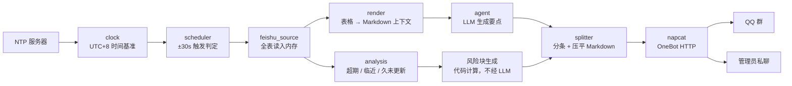

[](LICENSE)
[](https://www.python.org/)
[]()
[](https://github.com/botuniverse/onebot-11)
[](https://github.com/NapNeko/NapCatQQ)
[]()
[](https://github.com/CoffeeCat0667/feishu_QQBot)

# feishu_QQBot

定时把**飞书多维表格**的项目数据拉进内存，交给 LLM 生成一段**进展通报**，再通过 **NapCat（OneBot v11）** 分条发送到 QQ 群；同时把运行日志私聊给管理员。

> **状态：设计阶段。** 本仓库当前只包含配置模板、许可证与文档，运行代码尚未提交。
> 设计文档 `PLAN.md`、真实配置 `config.json` 与 `ThirdParty/` 均被 `.gitignore` 排除。

---

## 特性

- **NTP 校时**：触发时间取自网络时间，不信任系统时钟；NTP 全挂时降级 HTTPS `Date` 头。
- **内存导出**：飞书全表读进内存后直接组装上下文，**不落盘**。
- **定时触发**：以 `config.json` 中的 UTC+8 时间数组为基准，误差窗口 ±30 秒，每个时间点每天只触发一次。
- **LLM 生成**：人设、语气、条数、格式全部由配置驱动，不写死在代码里。
- **风险分块 @**：按负责人聚合超期 / 临近 / 久未更新任务，一人一条消息，块首直接 `@`。
- **日志上报**：每次运行一条汇总，错误即时上报给管理员；NapCat 不可用时熔断，避免上报风暴。
- **不读群消息**：v0.1 只发不收，群消息监听留作后续版本。

---

## 工作原理



顺序固定：**标题 → 全局要点 → 按人 @ 块**。

---

## 消息形态

第一条是日期标题，随后是 3~6 条要点，最后是每人一条风险块：

```text
2026 年 1 月 1 日 进展通报

⟨要点 1，20~60 字，可点名任务与数字⟩
⟨要点 2⟩
⟨要点 3⟩
...

@⟨负责人⟩ 的进度风险：
⟨任务名⟩（⟨状态⟩，预计 ⟨日期⟩，已逾期 ⟨N⟩ 天，进度 ⟨xx⟩%，⟨优先级⟩，⟨职能组⟩）
⟨任务名⟩（⟨状态⟩，预计 ⟨日期⟩，还剩 ⟨N⟩ 天，⟨优先级⟩，⟨职能组⟩）
```

- 空字段直接省略，不写「无」。
- 同一个人内部按 **优先级 P0→P3 → 逾期天数降序** 排列。
- 匹配不到 QQ 的负责人照常发送，只是不会被真正 `@` 到。

---

## 快速开始

### 1. 依赖

- Python **3.10+**（`smolagents` 要求）
- [NapCatQQ](https://github.com/NapNeko/NapCatQQ) 已登录，且开启 **OneBot HTTP** 服务
- 一份可读的飞书多维表格（需要 `app_token` 与 `personal_base_token`）

```bash
pip install -r requirements.txt
```

### 2. 配置

```bash
cp config_example.json config.json
```

然后填写 `config.json` 中的必填项：

| 字段 | 说明 |
|---|---|
| `napcat.http_server.token` | OneBot HTTP 鉴权 token，自己生成一串随机值 |
| `napcat.webui.login_hash` | NapCat WebUI 登录 hash，仅 `--provision` 使用 |
| `napcat.connect.host` | 程序连 NapCat 的地址（同机 `127.0.0.1`，跨机填对方 IP） |
| `targets[].name` | 目标群名或群号 |
| `admin[].id` | 管理员 QQ 号（收运行日志） |
| `llm.api_key` / `base_url` / `model_id` | 任意 OpenAI 兼容接口 |
| `feishu.config_path` | 飞书导出配置的路径（含 `personal_base_token`，**不要提交**） |

> `config.json` 已在 `.gitignore` 中；也支持环境变量覆盖：
> `QQBOT_LLM_API_KEY`、`QQBOT_NAPCAT_TOKEN`。

### 3. NapCat 端

`napcat.http_server` 是 NapCat `network.httpServers[]` 的完整镜像，程序会把它推送过去：

```json
{
  "name": "qqbot",
  "enable": true,
  "host": "0.0.0.0",
  "port": 3000,
  "enableCors": true,
  "enableWebsocket": false,
  "messagePostFormat": "array",
  "token": "<与 config.json 一致>",
  "debug": false
}
```

```bash
python -m qqbot --provision   # 推送并回读校验
python -m qqbot --check       # 校时 / 登录 / 目标解析 / 群成员
```

### 4. 运行（规划中的命令）

```bash
python -m qqbot            # 常驻：首次启动先跑一次，之后按时间表触发
python -m qqbot --once     # 立即跑一次
python -m qqbot --dry-run  # 只打印，不发送
```

---

## 配置结构

```text
config.json
├── schedule      触发时间（UTC+8）、容差、轮询间隔、首启补跑
├── time_sync     NTP 服务器、超时、重同步周期、HTTP 兜底
├── napcat        OneBot HTTP 服务端配置、客户端连接参数、WebUI
├── targets       通报目的地（群 / 好友）
├── admin         日志目的地
├── feishu        导出配置路径、表格名、渲染上限
├── llm           api_key / base_url / model_id / 温度 / 重试
├── prompt        人设、语言风格、输出格式、任务提示
├── risk          临近天数、久未更新天数、姓名→QQ 手工映射
├── send          单条字数上限、发送间隔、是否压平 Markdown
└── logging       日志级别、合并周期、错误即时发送
```

完整的字段说明与默认值见 [`config_example.json`](config_example.json)。

---

## 风险判定口径

| 概念 | 定义 |
|---|---|
| 未完成 | `任务状态 ≠ 已完成` |
| 超期 | 未完成且 `预计完成日 < 今天`（UTC+8） |
| 临近 | 未完成且 `0 ≤ 距截止天数 ≤ near_days` |
| 久未更新 | 该负责人所有任务中 `max(最后更新时间)` 超过 `idle_days` |
| 入列条件 | 以上任一命中；已有超期/临近的人不再重复输出「无更新」行 |

---

## 第三方依赖

本仓库**不包含**以下内容，需要自行准备：

| 项目 | 用途 | 说明 |
|---|---|---|
| `ThirdParty/feishu_export/` | 飞书多维表格导出 | 内含 `personal_base_token`，属于密钥，不入库 |
| `ThirdParty/NapCatQQ/` | QQ 协议端 | 独立部署，通过 OneBot HTTP 与本程序通信 |
| `ThirdParty/smolagents/` | Agent 框架 | 也可直接 `pip install smolagents` |

---

## 安全须知

- `config.json`、`PLAN.md`、`ThirdParty/` 均在 `.gitignore` 中，请勿用 `git add -f` 强制提交。
- 日志中会对 `api_key`、OneBot `token`、飞书 `personal_base_token` 打码。
- 若把 OneBot HTTP 绑定在 `0.0.0.0`，请务必设置非空 token，并保证端口不暴露到公网。
- 飞书的 `personal_base_token` 权限等同于文档所有者，泄露后请立即在飞书后台重置。

---

## 里程碑

| 阶段 | 内容 | 状态 |
|---|---|---|
| M1 | 配置、校时、触发、渲染、分条 | 规划中 |
| M2 | 飞书数据通路（纯内存） | 规划中 |
| M3 | NapCat OneBot HTTP 收发 | 规划中 |
| M4 | Agent 生成与流水线编排 | 规划中 |
| M5 | 日志上报与常驻部署 | 规划中 |

---

## 许可证

本项目基于 [MIT License](LICENSE) 开源。
